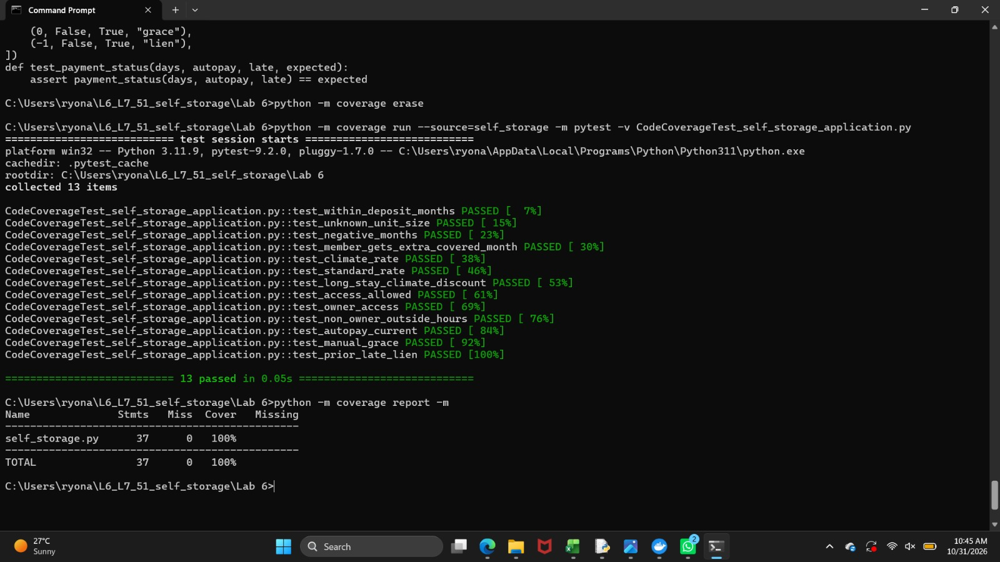
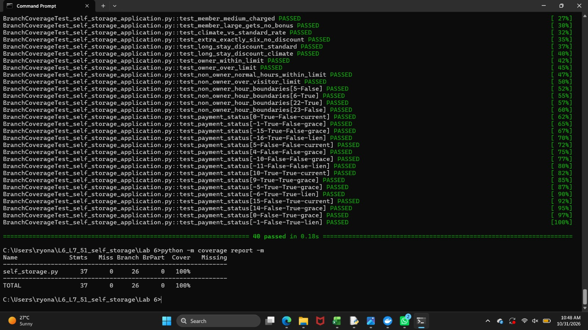

# L6_L7_51 – Self Storage

Lab 6: Code and Branch Coverage Analysis

## About

`self_storage.py` is a small Python module with three functions:

- `rent_due(unit_size, months, is_climate, is_member)` works out the rent owed beyond the deposit months, with a long-stay discount.
- `access_allowed(hour, visitors, is_owner)` decides whether a visit is allowed, by role, hour and visitor count.
- `payment_status(days_to_due, is_autopay, has_prior_late)` returns `current`, `grace` or `lien`.

This lab measures how much of that code the tests actually exercise, using line coverage and branch coverage, and adds tests until both pass 90%.

## Files

| File | Description |
|------|-------------|
| `self_storage.py` | The module under test |
| `test_self_storage.py` | Starter tests (2 tests, 38% line coverage) |
| `CodeCoverageTest_self_storage_application.py` | 13 tests for line coverage (100%) |
| `BranchCoverageTest_self_storage_application.py` | 40 tests for branch coverage (100%) |
| `Code_Coverage_Result.jpeg` | Terminal screenshot of the line coverage run |
| `Branch_Coverage_Result.jpeg` | Terminal screenshot of the branch coverage run |

## Setup

```
pip install coverage pytest
```

## How to run

Run these from inside the `Lab 6` folder.

**Line coverage**

```
coverage erase
coverage run -m pytest CodeCoverageTest_self_storage_application.py
coverage report -m --include=self_storage.py
```

**Branch coverage**

```
coverage erase
coverage run --branch -m pytest BranchCoverageTest_self_storage_application.py
coverage report -m --include=self_storage.py
```

If `coverage` is not recognised, use `python -m coverage` instead.

## Results

| Test suite | Tests | Line coverage | Branch coverage |
|------------|-------|---------------|-----------------|
| Starter `test_self_storage.py` | 2 | 38% | 32% (with `--branch`) |
| `CodeCoverageTest_...` | 13 | 100% | 98% (branch `21->23` partial) |
| `BranchCoverageTest_...` | 40 | 100% | 100% (26 of 26 branches) |

### Line coverage



### Branch coverage



## What this shows

The 13-test suite reaches 100% of lines, yet with `--branch` it still leaves one branch untested: the false side of `if is_climate:` inside the long-stay discount. A line report cannot see that gap, because no line goes missing. The 40-test suite adds a non-climate long-stay case and boundary values (0 months, 6 vs 7 extra months, hours 5, 6, 22, 23, and every payment cutoff), which closes it.

## Commits

1. Add code coverage test cases
2. Add branch coverage test cases
3. Add the terminal screenshots

Lab 7 will be added to this repo later.
